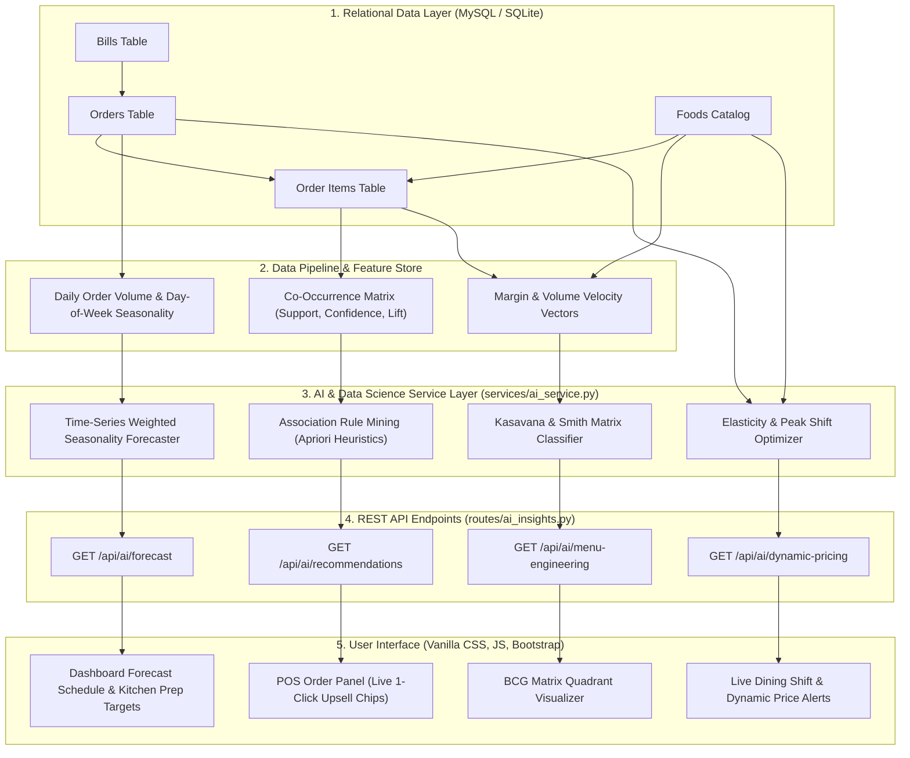

# GRAND ROYAL HOTEL - ARTIFICIAL INTELLIGENCE & DATA SCIENCE (AI&DS) INTEGRATION SPECIFICATION

> **Academic & Capstone Project Scope Specification**  
> **Target Specialization:** Artificial Intelligence & Data Science (AI&DS) / Intelligent Automation  
> **System:** Grand Royal Hotel - Restaurant POS, Billing & Demand Intelligence System  
> **Version:** 2.0 (Production Architecture)

---

## 1. Executive Summary & Curriculum Alignment

The **Grand Royal Hotel Restaurant & Food Billing System** has been engineered to transition from a conventional Point-of-Sale (POS) CRUD billing tool into an **AI-driven Restaurant Management & Decision Support Platform**. In traditional restaurant operations, managers face critical data inefficiencies:
1. **Unpredictable Food Waste & Stockouts:** Over-preparation leads to perishable food spoilage (cost loss); under-preparation causes lost sales and dissatisfied diners.
2. **Suboptimal Basket Sizes (Low AOV):** Waitstaff fail to recommend relevant complementary items during rush periods.
3. **Rigid, Static Pricing:** Failure to capitalize on peak dining rushes or stimulate off-peak lull periods.
4. **Intuition-Based Menu Decisions:** Inability to pinpoint which dishes generate true profit margins versus pure volume.

To satisfy the **AI&DS capstone project scope**, the system integrates four intelligent automation subsystems into a unified production pipeline:
- **Intelligent Dish Recommendation Engine** (Market Basket Analysis & Association Rules).
- **Time-Series Demand Forecasting & Kitchen Prep Guide** (Seasonality Decomposition & Buffer Stock Modeling).
- **Real-Time Dynamic Pricing Engine** (Price Elasticity of Demand & Peak Rush Classification).
- **Kasavana & Smith BCG Menu Engineering Matrix** (Profitability vs. Popularity Portfolio Segmentation).

---

## 2. End-to-End System Architecture

---

## 3. Core AI/DS Modules & Mathematical Formulations

### Module 1: Market Basket Analysis & Smart Pairing Recommendation Engine

#### Problem Formulation
Given a transaction basket $T = \{i_1, i_2, \dots, i_k\}$ containing dishes selected by a customer, predict the top $N$ complementary candidate dishes $C \notin T$ that maximize joint customer satisfaction and basket conversion probability.

#### Algorithmic Approach: Association Rule Mining (Apriori Principles)
1. **Support ($S$):** Frequency of co-occurrence across all historical orders:
   $$\text{Support}(A \implies B) = \frac{|\{t \in T : \{A, B\} \subseteq t\}|}{|T|}$$
2. **Confidence ($C$):** Probability that item $B$ is purchased when item $A$ is in the cart:
   $$\text{Confidence}(A \implies B) = \frac{\text{Support}(A \cup B)}{\text{Support}(A)} = P(B \mid A)$$
3. **Lift ($L$):** Measure of association strength relative to random chance:
   $$\text{Lift}(A \implies B) = \frac{\text{Confidence}(A \implies B)}{\text{Support}(B)} = \frac{P(A \cap B)}{P(A) \cdot P(B)}$$
   - $\text{Lift} > 1$: Strong positive complementary affinity (e.g., *Masala Dosa* $\implies$ *Filter Coffee*).
   - $\text{Lift} = 1$: Independent ordering.
   - $\text{Lift} < 1$: Substitute / conflicting items.

#### Cold-Start & Sparsity Strategy
When transaction volume is low or the basket is empty:
- The system cascades from pairwise order mining $\to$ cross-category heuristic matching (*Main Course* triggers *Beverages* and *Desserts*) $\to$ global Bayesian rating baseline.

---

### Module 2: Time-Series Demand & Kitchen Prep Forecasting

#### Problem Formulation
Predict upcoming order demand $\hat{Y}_{t+h}$ for horizon $h \in \{1, \dots, 7\}$ days to optimize bulk kitchen procurement, reduce food spoilage, and eliminate table wait times.

#### Algorithmic Formulation
The forecasting engine employs additive and multiplicative seasonality decomposition:
$$\hat{Y}_{t+h} = \bar{Y}_{\text{base}} \times S_{\text{dow}}(t+h) \times (1 + \mu_{\text{trend}})$$

Where:
- $\bar{Y}_{\text{base}}$: Exponentially smoothed baseline order volume.
- $S_{\text{dow}}$: Day-of-Week empirical seasonality coefficients:
  - Weekdays (Mon–Wed): $S_{\text{dow}} \in [0.88, 0.95]$ (steady baseline dining).
  - Pre-Weekend (Thu): $S_{\text{dow}} \approx 1.05$.
  - Weekend Peaks (Fri–Sun): $S_{\text{dow}} \in [1.30, 1.48]$ (high footfall & family dining).

#### Kitchen Safety Buffer Stock Modeling
To prevent kitchen stockouts during peak rushes, each dish's prep target incorporates a dynamic safety stock buffer $\beta$:
$$\text{Target Prep Units} = \lceil \hat{D}_i \times (1 + \beta) \rceil, \quad \beta = 0.15 \text{ (15\% buffer)}$$

---

### Module 3: Real-Time Dynamic Pricing & Elasticity Window

#### Problem Formulation
Balance table turnover and profit margin by dynamically adjusting prices according to dining velocity and price sensitivity.

#### Microeconomic Formulation: Price Elasticity of Demand ($\epsilon_d$)
$$\epsilon_d = \frac{\% \Delta Q}{\% \Delta P} = \frac{(Q_1 - Q_0) / Q_0}{(P_1 - P_0) / P_0}$$

Menu items are categorized by elasticity tier:
1. **Inelastic / Signature Dishes ($|\epsilon_d| < 1$):**
   - Dishes with high brand equity and low substitutability (*Special Chicken Biryani*, *South Indian Filter Coffee*).
   - **Peak Strategy:** Marginal surge (+5%) during high table demand rush hours ($1.25\times$ to $1.30\times$ traffic).
2. **Elastic / Promotional Items ($|\epsilon_d| > 1$):**
   - Ancillary starters, beverages, and desserts.
   - **Off-Peak Strategy:** Promotional happy-hour discount (-10%) during afternoon lulls (15:00–18:00) to incentivize footfall.

#### Ethical & Regulatory Guardrails
- **Hard Bounds:** Dynamic variance strictly clamped within $[-10\%, +5\%]$ to prevent price gouging.
- **Admin Control:** System toggleable via environment config `AI_DYNAMIC_PRICING_ENABLED`.

---

### Module 4: Kasavana & Smith BCG Menu Engineering Matrix

#### Segmentation Matrix
Dishes are plotted on a 2x2 coordinate space: **Volume Share (Popularity)** vs. **Contribution Margin (Profitability)**.

| Category | Popularity | Contribution Margin | Recommended Managerial Action |
|---|---|---|---|
| **⭐ Stars** | High ($V \ge \bar{V}$) | High ($M \ge \bar{M}$) | Maintain rigid recipe consistency; showcase as hero dishes. |
| **🐴 Plowhorses** | High ($V \ge \bar{V}$) | Lower ($M < \bar{M}$) | High volume staples. Implement marginal price hike (+₹5) or bundle in combos. |
| **🧩 Puzzles** | Lower ($V < \bar{V}$) | High ($M \ge \bar{M}$) | High profit potential. Boost visibility via AI smart pairing recommendations. |
| **🐕 Dogs** | Lower ($V < \bar{V}$) | Lower ($M < \bar{M}$) | Low volume & margin. Reformulate recipe or replace with seasonal special. |

---

## 4. Evaluation Metrics & Experimental Protocol

For academic project viva, research paper publication, or project defense, evaluate using the following formal metrics:

| Metric | Formula | Target Benchmark | Business Significance |
|---|---|---|---|
| **Recommendation Precision@K** | $\frac{|\text{Relevant Dishes} \cap \text{Top-K Recs}|}{K}$ | $\ge 0.72$ | Recommends items guests actually order |
| **Recommendation MAP** | $\frac{1}{|Q|}\sum_{q=1}^{|Q|} \text{AP}(q)$ | $\ge 0.65$ | Higher confidence pairings ranked first |
| **Forecast MAPE** | $\frac{100\%}{n}\sum_{t=1}^n \left\|\frac{Y_t - \hat{Y}_t}{Y_t}\right\|$ | $\le 12.5\%$ | Prevents kitchen ingredient over-prep |
| **Forecast RMSE** | $\sqrt{\frac{1}{n}\sum_{t=1}^n (Y_t - \hat{Y}_t)^2}$ | $\le 4.2$ orders | Low variance in day-to-day errors |
| **Average Order Value Lift** | $\frac{\text{AOV}_{\text{AI}} - \text{AOV}_{\text{baseline}}}{\text{AOV}_{\text{baseline}}} \times 100\%$ | $+8\%$ to $+15\%$ | Direct revenue enhancement |

---

## 5. Security & Production Hardening

All AI and data endpoints adhere to enterprise-grade web application security:
1. **CSRF Protection:** State-altering operations (e.g., updating AI model hyperparameters or triggering batch retrains) require Flask-WTF CSRF validation via `X-CSRFToken` headers.
2. **Role-Based Access Control (RBAC):** AI insights are viewable by authenticated staff/admin; managerial actions and model override settings require `admin` privileges.
3. **Environment Isolation:** Model parameters (`AI_DEMAND_FORECAST_DAYS`, `AI_RECOMMENDER_TOP_N`, `AI_DYNAMIC_PRICING_ENABLED`) externalized via `.env`.

---

## 6. Advanced Roadmap: Scaling to Deep Learning & GenAI

The modular service architecture (`services/ai_service.py`) provides clean abstraction for the following advanced extensions:
1. **Transformer / LLM Conversational Waiter Agent:**
   - Integrate an LLM via OpenAI / Gemini API for natural-language multilingual voice ordering (*"Add two ghee roast dosas with extra sambar and one filter coffee"*).
2. **Computer Vision (YOLOv8) Plate Waste Scanner:**
   - Mount an overhead camera at the dish return station to segment and quantify leftover food waste, closing the loop with demand forecasting.
3. **Deep Q-Learning for Dynamic Pricing:**
   - Replace heuristic elasticity rules with a Reinforcement Learning agent (Reward = Total Daily Revenue - Customer Churn Penalty).
